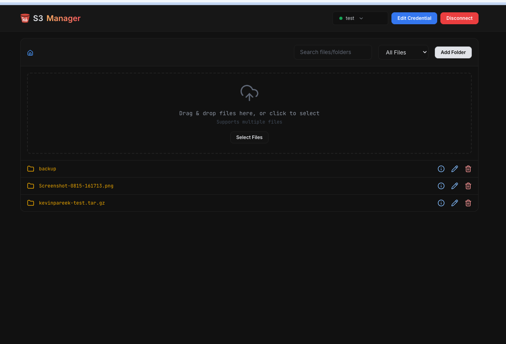
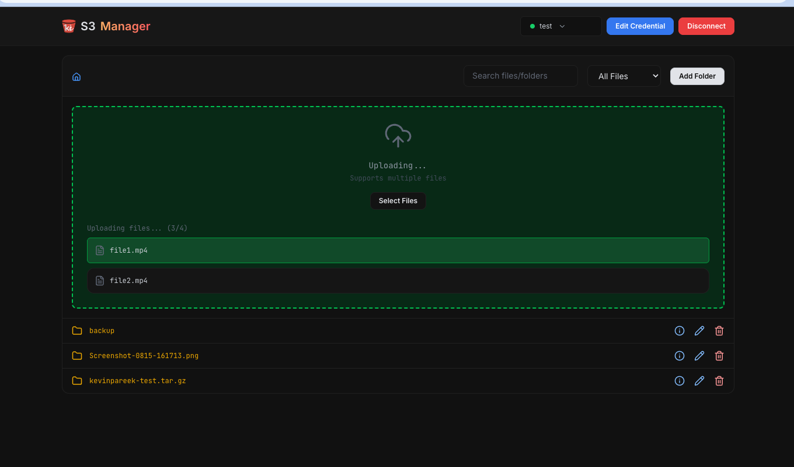
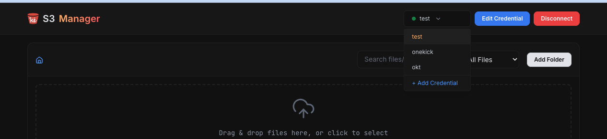
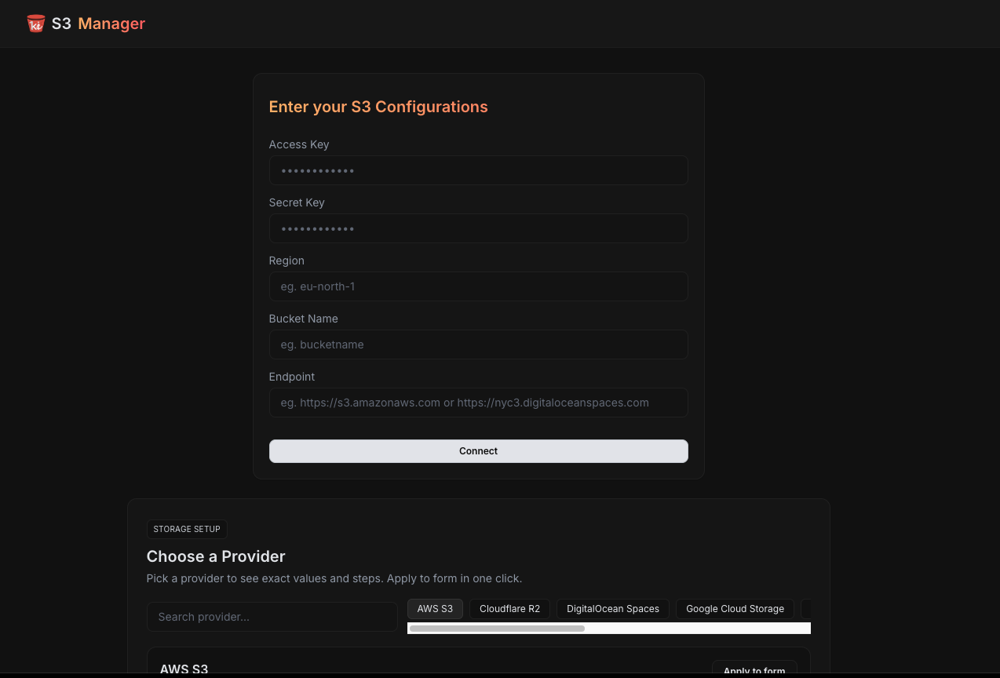

# S3 Storage Manager

[](https://github.com/allswebtech/s3-storage-manager/actions/workflows/ci.yml)
[](https://github.com/allswebtech/s3-storage-manager/releases)
[](LICENSE)

A free, open-source **web file manager for Amazon S3 and S3-compatible object storage**.
Browse buckets, upload by drag and drop, rename, move, copy, preview, edit and share
files from your browser. It is made for AWS S3 and S3-compatible providers such as
Cloudflare R2, MinIO, DigitalOcean Spaces, Wasabi, Backblaze B2 and Google Cloud Storage.

There is no backend. The app is a static site built with React and Vite; it signs
requests in your browser with the AWS SDK and talks directly to your storage endpoint.

**Live demo: <https://s3.allsweb.net>** (enter your own bucket and keys; they stay in
your browser).



## Contents

- [Features](#features)
- [Quick start](#quick-start)
- [Connect a bucket](#connect-a-bucket)
- [Bucket CORS and permissions](#bucket-cors-and-permissions)
- [Security](#security)
- [Deploy your own copy](#deploy-your-own-copy)
- [Development and tests](#development-and-tests)
- [Troubleshooting](#troubleshooting)
- [Limits](#limits)
- [FAQ](#faq)
- [License](#license)

## Features

**Files and folders**

- Drag-and-drop upload of files and whole folders, with a queue, progress and cancel
- Multipart upload for large files (parallel parts; part size grows automatically so
  very large files stay within S3's 10,000-part limit)
- Conflict handling on upload: replace, keep both, or skip
- Create folders; rename, copy and move files and folders
- Delete single items or a selection, including folders with thousands of objects
- Download a file, or a folder or selection as a ZIP
- Recursive search and filter by type (images, video, audio, documents, code, archives)
- Folder navigation with breadcrumbs, the browser Back and Forward buttons, and a
  shareable `?path=` address

**Preview and share**

- Preview images, video, audio and PDF; view CSV as a table
- Edit text, Markdown and JSON files in the browser and save them back
- Details for every item: size, dates, folder totals
- Signed view and download links (valid for one hour), or links on your public
  bucket/CDN address if you set one




**Accounts**

- Save several buckets or providers and switch between them
- Provider presets for AWS S3, Cloudflare R2, DigitalOcean Spaces, Google Cloud Storage,
  IBM Cloud Object Storage, Oracle Cloud Object Storage, Scaleway and Wasabi
- The connection is tested before a credential is saved



## Quick start

You need Node.js 22.13 or later (24 and 26 work too) and npm.

```bash
git clone https://github.com/allswebtech/s3-storage-manager.git
cd s3-storage-manager
npm ci
npm run dev
```

Open <http://localhost:5173>. To make a production build, run `npm run build` and serve
the `dist/` folder.

## Connect a bucket

On first start the app asks for a credential:

| Field | What to enter |
|---|---|
| **Bucket name** | The name of the bucket to open |
| **Access key / Secret key** | An access key that may list, read, write and delete in that bucket |
| **Region** | For example `us-east-1`; `auto` for Cloudflare R2 |
| **Endpoint** | The provider's S3 endpoint, for example `https://s3.us-east-1.amazonaws.com` or `https://<account-id>.r2.cloudflarestorage.com` |
| **Public URL** (optional) | The public address of the bucket or its CDN. If set, "view" links use it instead of a signed link |



The form has a preset for each supported provider and shows the CORS rule and the access
policy to copy for your bucket.

## Bucket CORS and permissions

A browser may only call your bucket if the bucket allows the address the app is served
from. Set this CORS rule on the bucket, with your own address in `AllowedOrigins`:

```json
[
  {
    "AllowedOrigins": ["https://your-domain.example"],
    "AllowedMethods": ["GET", "PUT", "POST", "DELETE", "HEAD"],
    "AllowedHeaders": ["*"],
    "ExposeHeaders": ["ETag"],
    "MaxAgeSeconds": 3000
  }
]
```

`ExposeHeaders: ["ETag"]` is required for multipart uploads.

The access key needs these permissions (replace `<bucket>`):

```json
{
  "Version": "2012-10-17",
  "Statement": [
    { "Effect": "Allow", "Action": ["s3:ListBucket"], "Resource": ["arn:aws:s3:::<bucket>"] },
    {
      "Effect": "Allow",
      "Action": ["s3:GetObject", "s3:PutObject", "s3:DeleteObject", "s3:AbortMultipartUpload"],
      "Resource": ["arn:aws:s3:::<bucket>/*"]
    }
  ]
}
```

## Security

- **Your keys stay in your browser.** They are saved in the browser's `localStorage` for
  the site you opened the app on, and are sent only to the storage endpoint you entered.
- Anyone who can use your browser profile, or run script on the same site address, can
  read them. Serve the app from an address you control and do not share that address with
  other apps.
- Use a dedicated access key limited to the bucket and the actions above, not an account
  root key. Rotate it regularly.
- Restrict the bucket's CORS `AllowedOrigins` to your own address instead of `*`.
- The production build sets a Content-Security-Policy that allows scripts only from the
  app itself.

To report a vulnerability, see [SECURITY.md](SECURITY.md).

## Deploy your own copy

`npm run build` produces a static site in `dist/`. Host it anywhere that serves static
files and sends unknown paths to `index.html`.

| Host | What to do |
|---|---|
| **GitHub Pages** | Fork the repository and enable Pages with "GitHub Actions" as the source. The included workflow `.github/workflows/pages.yml` builds and deploys on every push to `main`, for a custom domain or a `user.github.io/repo` address |
| **Vercel** | Import the repository. `vercel.json` already contains the rewrite and the security headers |
| **Apache or LiteSpeed** | Upload `dist/`. It contains an `.htaccess` with the rewrite, security headers and cache rules |
| **Nginx** | Serve `dist/` with `try_files $uri /index.html;` |
| **Cloudflare Pages, Netlify** | Build command `npm run build`, output folder `dist`, and a single-page-app fallback to `/index.html` |

To serve the app under a sub-path, set the base path at build time:

```bash
VITE_BASE_PATH=/files/ npm run build
```

## Development and tests

```bash
npm run lint          # ESLint
npm test              # unit tests + integration tests against a local S3 server
npm run test:e2e      # Playwright tests against the production build
```

The integration and end-to-end tests need a local S3-compatible server. With Docker
installed:

```bash
npm run s3:start      # starts Versity Gateway on http://localhost:7070
npm run s3:stop
```

The same checks run in GitHub Actions on every pull request. See
[CONTRIBUTING.md](CONTRIBUTING.md).

| Path | Purpose |
|---|---|
| `src/api/` | One module per S3 operation (list, upload, copy, move, delete, search, sign) |
| `src/components/`, `src/pages/` | The interface |
| `src/helpers/` | Key and path handling, credential storage, formatting |
| `config/security-headers.js` | The Content-Security-Policy and other headers, used by the build, `vercel.json` and `.htaccess` |
| `test/`, `e2e/` | Unit, integration and end-to-end tests |

## Troubleshooting

| Symptom | Likely cause and fix |
|---|---|
| "Network or CORS error" when saving a credential or listing | The bucket has no CORS rule for the address the app is served from. Add the rule above |
| `Access denied` | The key lacks `s3:ListBucket` on the bucket or the object permissions on `<bucket>/*` |
| `SignatureDoesNotMatch` | Wrong secret key, region or endpoint. Use the exact endpoint and region your provider documents |
| Large uploads fail with "did not return an ETag" | The CORS rule does not expose the `ETag` header |
| Cloudflare R2 | Use the `https://<account-id>.r2.cloudflarestorage.com` endpoint and region `auto` |
| Google Cloud Storage | Use the interoperability endpoint `https://storage.googleapis.com` with HMAC keys |
| A page reload shows "404" on your own host | The host does not send unknown paths to `index.html`. See [Deploy your own copy](#deploy-your-own-copy) |

## Limits

- Renaming or moving is a copy followed by a delete, as S3 has no rename. For a large
  folder this takes time and your provider may charge for the requests.
- Copying, moving or renaming a single object larger than 5 GB is not supported.
- A ZIP download is built in browser memory and is limited to 1 GiB in total.
- Text files up to 1.5 MB can be edited in the browser.
- Search and folder totals list every object under the folder, which is slow for very
  large folders.
- The app uses path-style addresses (`endpoint/bucket/key`).

## FAQ

**Is there a server that sees my files or keys?**
No. The app is static files. Your browser talks directly to your storage provider.

**Which providers work?**
Any provider with an S3-compatible API and CORS support. The automated tests run against
an S3-compatible test server; the presets for the providers listed above are provided for
convenience, and behaviour can differ between providers.

**Can I use it for several buckets?**
Yes. Add one credential per bucket and switch from the menu in the header.

**Can I host it on my own domain?**
Yes, and for regular use you should. See [Deploy your own copy](#deploy-your-own-copy).

**Does it work on mobile?**
The layout is responsive. The automated tests cover desktop Chromium.

## License

Released under the [MIT license](LICENSE).

---

Maintained by [AllsWeb](https://www.allsweb.com): managed IT services, hosting and AI
automation.
