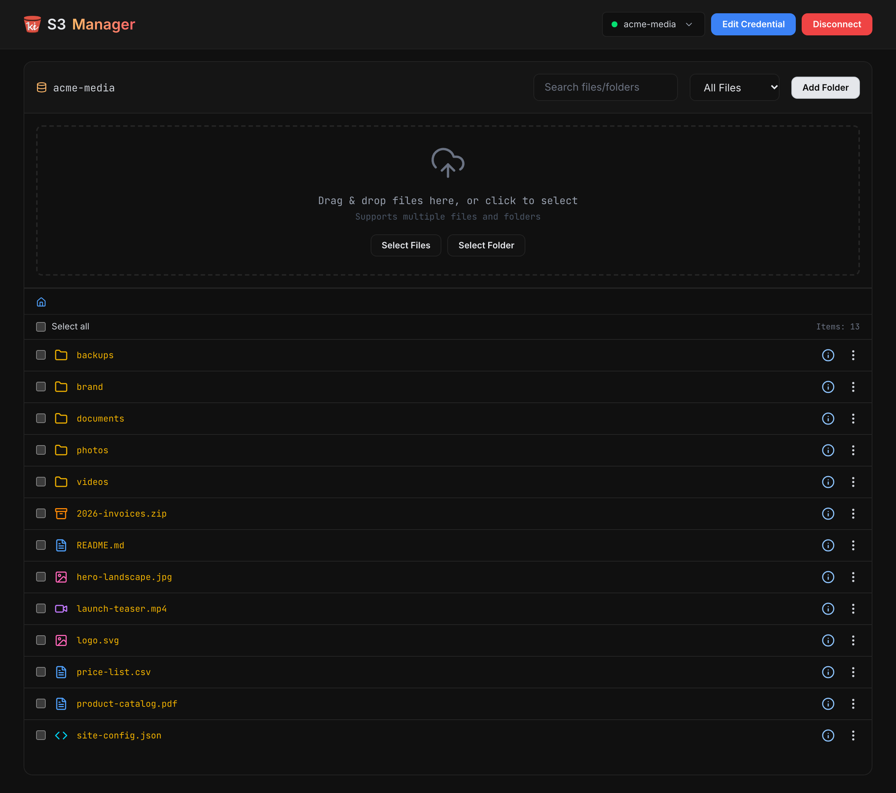
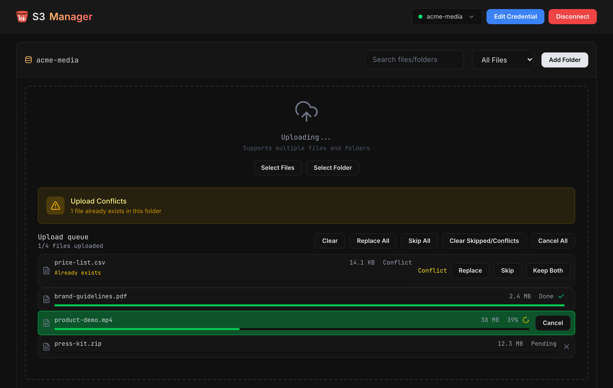
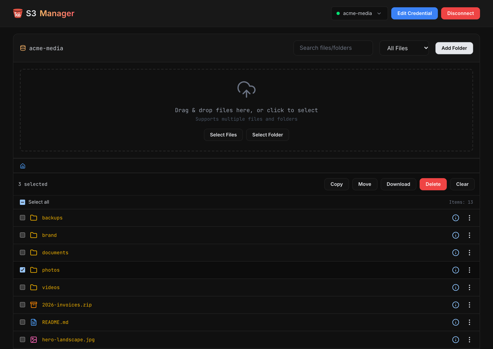
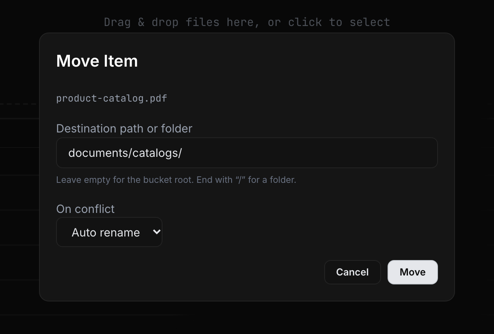
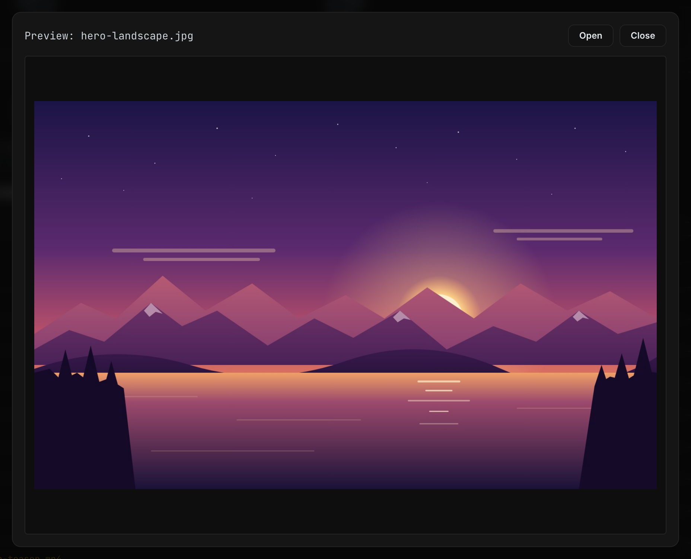
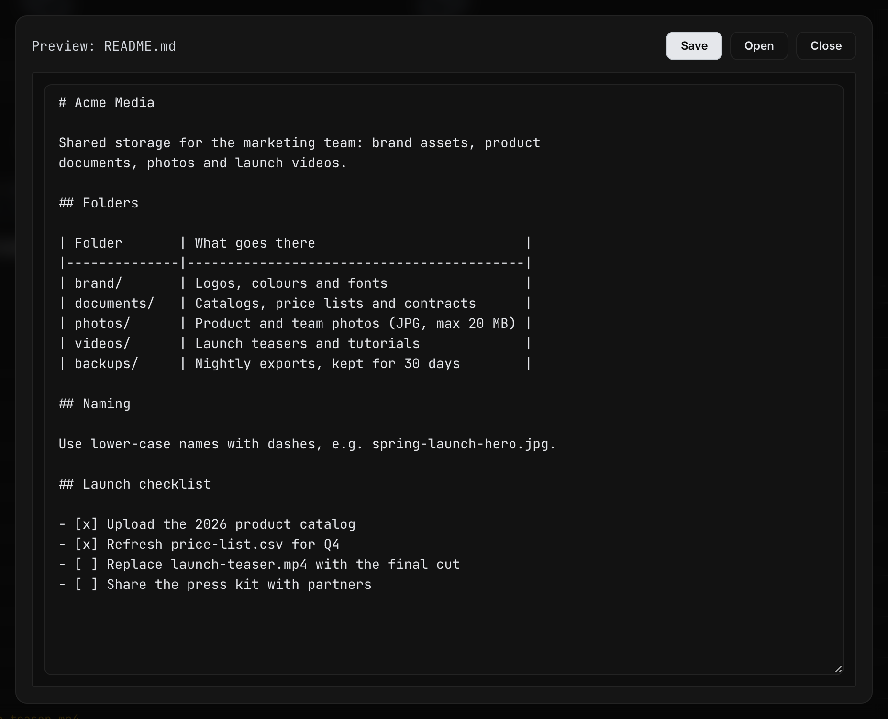
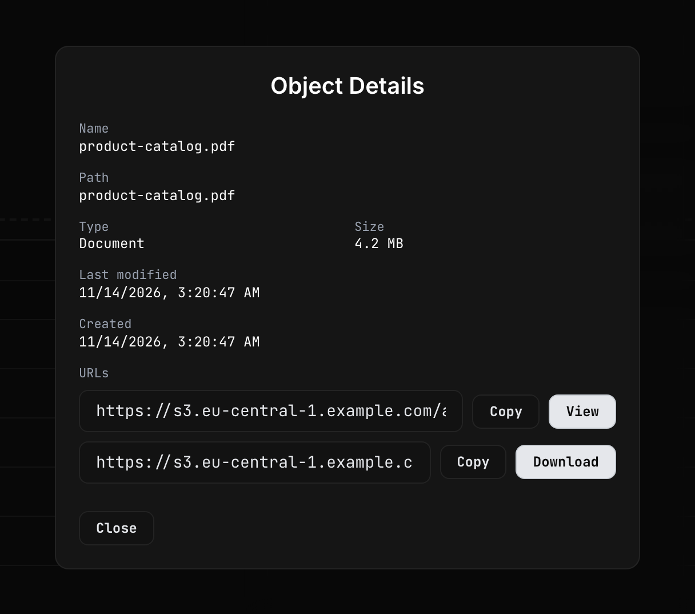
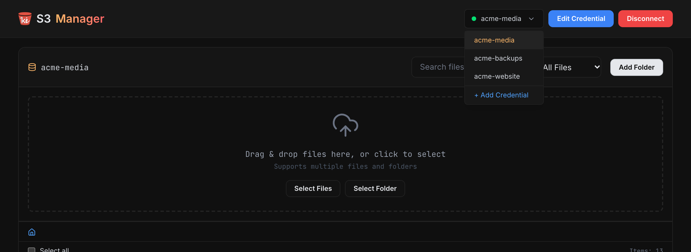
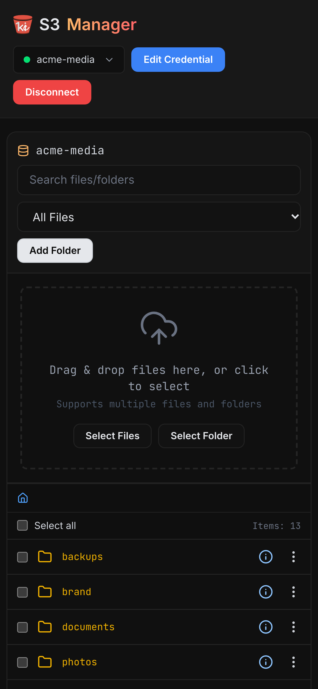
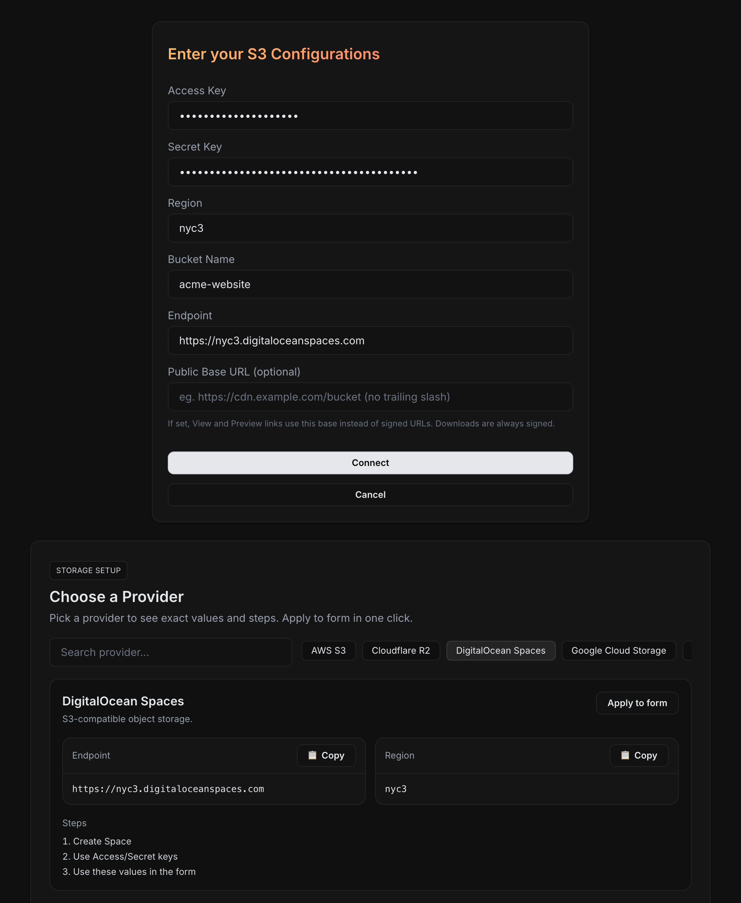

# S3 Storage Manager

[](https://github.com/allswebtech/s3-storage-manager/actions/workflows/ci.yml)
[](https://github.com/allswebtech/s3-storage-manager/releases)
[](LICENSE)

**A file manager for your S3 bucket that runs in the browser.** Open the page, enter your
bucket and access key, and manage your files like in a desktop file manager: upload,
browse, rename, move, preview, edit and share.

It works with **Amazon S3** and with **S3-compatible storage** such as Cloudflare R2,
MinIO, DigitalOcean Spaces, Wasabi, Backblaze B2 and Google Cloud Storage. It is free and
open source.

### [Open the live demo → s3.allsweb.net](https://s3.allsweb.net)



## How it works

- It is a **web page, not a server**. There is nothing to install on your storage and no
  database.
- You type in your bucket name, endpoint and access key. Your browser then talks
  **directly to your storage provider**.
- **Your keys stay in your browser.** They are never sent to us or to any other server.

## Contents

- [What you can do](#what-you-can-do)
- [Get started in three steps](#get-started-in-three-steps)
- [Settings for your provider](#settings-for-your-provider)
- [Is it safe?](#is-it-safe)
- [Host your own copy](#host-your-own-copy)
- [Troubleshooting](#troubleshooting)
- [Limits](#limits)
- [Questions and answers](#questions-and-answers)
- [For developers](#for-developers)
- [License](#license)

## What you can do

### Upload files and folders

Drag files or whole folders onto the page. Uploads run in a queue with a progress bar,
and you can cancel them. Large files are sent in parts, several parts at a time. If a
file with the same name already exists, you choose: **replace**, **keep both** or
**skip**.



### Organise

Create folders. Rename, copy and move files and folders. Select several items and copy,
move, download or delete them in one go. Search the whole folder tree, or show only
images, videos, documents and so on.





### Preview and edit

Look at images, videos, audio and PDF files without downloading them. Open text,
Markdown, JSON and CSV files, and edit and save text files right in the browser.





### Download and share

Download a single file, or a folder or a selection as one ZIP file. For every file you
get a **view link** and a **download link** to share. The links are signed and stop
working after one hour. If your bucket has a public address or a CDN, the view link can
use that instead.



### Several buckets

Save as many buckets as you like, also from different providers, and switch between them
in the header.



### On a phone

The page adapts to small screens.



## Get started in three steps

### 1. Create an access key

In your storage provider's console, create an access key that may read and write **only
the bucket you want to manage**. Do not use your account's main (root) key.

On AWS, this policy is enough. Replace `my-bucket` with your bucket name:

```json
{
  "Version": "2012-10-17",
  "Statement": [
    { "Effect": "Allow", "Action": ["s3:ListBucket"], "Resource": ["arn:aws:s3:::my-bucket"] },
    {
      "Effect": "Allow",
      "Action": ["s3:GetObject", "s3:PutObject", "s3:DeleteObject", "s3:AbortMultipartUpload"],
      "Resource": ["arn:aws:s3:::my-bucket/*"]
    }
  ]
}
```

### 2. Allow the page to reach your bucket (CORS)

A browser may only talk to a bucket that allows the website it is on. Add this **CORS
rule** to your bucket. In `AllowedOrigins`, put the address where you use the app:

```json
[
  {
    "AllowedOrigins": ["https://s3.allsweb.net"],
    "AllowedMethods": ["GET", "PUT", "POST", "DELETE", "HEAD"],
    "AllowedHeaders": ["*"],
    "ExposeHeaders": ["ETag"],
    "MaxAgeSeconds": 3000
  }
]
```

If you host your own copy, use your own address, for example
`https://files.example.com`. For local development it is `http://localhost:5173`.
`ExposeHeaders: ["ETag"]` is needed for large uploads.

### 3. Open the app and connect

Open [s3.allsweb.net](https://s3.allsweb.net) (or your own copy), pick your provider and
fill in the form. The app tests the connection before it saves.

| Field | What to enter |
|---|---|
| **Access key** and **Secret key** | The key you created in step 1 |
| **Region** | Your bucket's region, for example `us-east-1` |
| **Bucket name** | The name of the bucket |
| **Endpoint** | Your provider's S3 address. See the table below |
| **Public Base URL** (optional) | The public address of the bucket or its CDN, if it has one |



## Settings for your provider

| Provider | Endpoint | Region |
|---|---|---|
| Amazon S3 | `https://s3.<region>.amazonaws.com` | For example `us-east-1`, `eu-central-1` |
| Cloudflare R2 | `https://<account-id>.r2.cloudflarestorage.com` | `auto` |
| DigitalOcean Spaces | `https://<region>.digitaloceanspaces.com` | For example `nyc3`, `fra1` |
| Wasabi | `https://s3.<region>.wasabisys.com` | For example `us-east-1` |
| Backblaze B2 | `https://s3.<region>.backblazeb2.com` | For example `us-west-004` |
| Google Cloud Storage | `https://storage.googleapis.com` (use HMAC keys) | Your bucket's location, for example `us-central1` |
| Scaleway | `https://s3.<region>.scw.cloud` | For example `fr-par` |
| MinIO or another self-hosted server | The address of your server, for example `https://minio.example.com` | Usually `us-east-1` |

The form has ready-made presets for AWS S3, Cloudflare R2, DigitalOcean Spaces, Google
Cloud Storage, IBM Cloud Object Storage, Oracle Cloud Object Storage, Scaleway and Wasabi.
For any other provider choose **Other** and enter its S3 endpoint.

## Is it safe?

The app has no server of its own, so there is nobody in the middle who could see your
files or keys. Still, keep these points in mind:

- Your keys are saved in your browser (`localStorage`) for the website address you opened
  the app on. Anyone who can use your browser profile can read them. On a shared
  computer, click **Disconnect** when you are done.
- Give the app a key that is limited to one bucket (step 1), and replace the key from
  time to time.
- In the CORS rule, list only the address you really use, not `*`.
- For regular use, [host your own copy](#host-your-own-copy) on an address you control.
- The production build sets a Content-Security-Policy that only allows the app's own
  scripts.

Found a security problem? Please report it privately: see [SECURITY.md](SECURITY.md).

## Host your own copy

The app is a folder of static files. Any web host can serve it.

**The quick way:** download the ZIP from the
[latest release](https://github.com/allswebtech/s3-storage-manager/releases/latest),
unpack it into the web root of your host, and you are done on Apache and LiteSpeed (the
ZIP contains an `.htaccess`).

**Or build it yourself** (Node.js 22.13 or newer):

```bash
git clone https://github.com/allswebtech/s3-storage-manager.git
cd s3-storage-manager
npm ci
npm run build        # the site is now in dist/
```

| Host | What to do |
|---|---|
| **GitHub Pages** | Fork this repository and set Pages to "GitHub Actions". The included workflow builds and publishes on every push to `main`. It works with a custom domain and with `user.github.io/repo` |
| **Vercel** | Import the repository. `vercel.json` has everything it needs |
| **Apache, LiteSpeed** | Upload `dist/`. The `.htaccess` is included |
| **Nginx** | Serve `dist/` and add `try_files $uri /index.html;` |
| **Cloudflare Pages, Netlify** | Build command `npm run build`, output folder `dist`, single-page-app fallback to `/index.html` |

The one thing every host must do: send unknown paths to `index.html`, so that reloading
a page works.

To put the app in a sub-folder such as `example.com/files/`, build it like this:

```bash
VITE_BASE_PATH=/files/ npm run build
```

Remember to add your own address to the bucket's CORS rule.

## Troubleshooting

| What you see | Why, and what to do |
|---|---|
| "Network or CORS error" | The bucket does not allow the website address yet. Add the CORS rule from step 2 |
| "Access denied" | The key may not list the bucket or read and write its objects. Check the policy from step 1 |
| "SignatureDoesNotMatch" | The secret key, the region or the endpoint is wrong. Compare them with your provider's console |
| Large uploads fail with "did not return an ETag" | The CORS rule is missing `"ExposeHeaders": ["ETag"]` |
| Cloudflare R2 does not connect | Use the `https://<account-id>.r2.cloudflarestorage.com` endpoint and the region `auto` |
| Google Cloud Storage does not connect | Use `https://storage.googleapis.com` and HMAC keys (Settings → Interoperability) |
| On your own host, reloading a page shows "404" | The host does not send unknown paths to `index.html`. See [Host your own copy](#host-your-own-copy) |

## Limits

- S3 has no real "rename". Renaming or moving copies the data and then deletes the
  original. For a big folder this takes a while, and your provider may charge for the
  requests.
- A single file larger than 5 GB can be uploaded, but not copied, moved or renamed.
- A ZIP download is put together in the browser's memory. It is limited to 1 GiB.
- Text files up to 1.5 MB can be edited in the browser.
- Search and folder sizes read the list of every file in the folder. In folders with a
  very large number of files this is slow.

## Questions and answers

**Do you see my files or my keys?**
No. There is no server behind the app. Your browser talks only to your storage provider.

**Does it cost anything?**
No. The app is free and open source (MIT license). You only pay your storage provider.

**Which providers work?**
Any provider that offers the S3 API and lets you set a CORS rule. The automated tests run
against an S3-compatible test server. Providers differ in small details, so if something
does not work with yours, please open an issue.

**Can I use the demo for real work?**
You can, but for regular use we recommend hosting your own copy on your own address. It
takes a few minutes.

**I closed the browser. Do I have to enter everything again?**
No. Your saved buckets stay in the browser until you remove them or clear the browser's
site data.

**How do I remove my keys?**
Click **Disconnect** in the header, or remove a single bucket under **Edit Credential**.

## For developers

```bash
npm ci
npm run dev           # http://localhost:5173
npm run lint
npm test              # unit tests and integration tests
npm run test:e2e      # browser tests against the production build
```

The integration and browser tests use a local S3-compatible server. With Docker
installed, start it with `npm run s3:start` and stop it with `npm run s3:stop`. The same
checks run in GitHub Actions on every pull request.

| Path | What is in it |
|---|---|
| `src/api/` | One file per storage action: list, upload, copy, move, delete, search, links |
| `src/components/`, `src/pages/` | The interface |
| `src/helpers/` | Paths and names, saved buckets, formatting |
| `config/security-headers.js` | The Content-Security-Policy and other headers, used by the build, `vercel.json` and `.htaccess` |
| `test/`, `e2e/` | Unit, integration and browser tests |
| `scripts/screenshots.mjs` | Regenerates the screenshots in this README (`npm run screenshots`) |

Built with React 19, Vite 8, Tailwind CSS 4 and the AWS SDK for JavaScript v3. To
contribute, see [CONTRIBUTING.md](CONTRIBUTING.md). Changes are listed in the
[changelog](CHANGELOG.md).

## License

Released under the [MIT license](LICENSE).

---

Maintained by [AllsWeb](https://www.allsweb.com): managed IT services, hosting and AI
automation.
